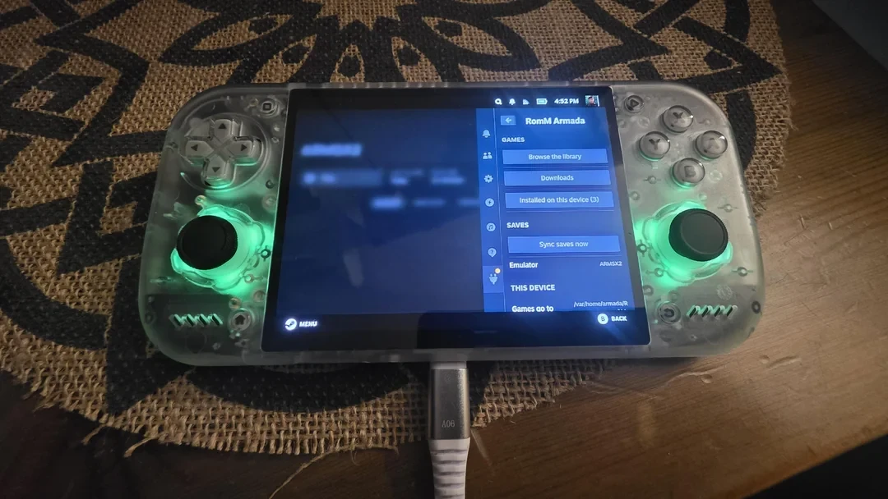
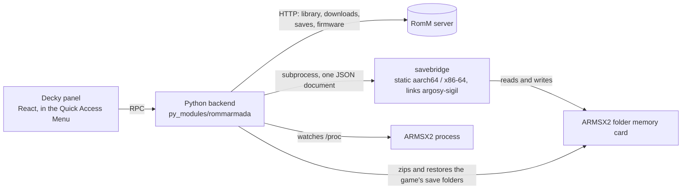

# RomM Armada



*RomM Armada in Decky's Quick Access Menu on a Retroid Nova running [Armada OS](https://armadaos.dev): browse your
RomM library, download into one folder, sync saves with one press.*

A [Decky Loader](https://decky.xyz) plugin that connects an Arm64 handheld to your self-hosted [RomM](https://romm.app)
server.

- **Downloads games** from your RomM library into one dedicated folder (default `~/ROMs`, or an SD card), with resume,
  checksums, a free-space check and a queue.
- **Syncs PlayStation 2 saves** (ARMSX2 or PCSX2) with RomM as the game's own save folders, tagged `armadaos`. A sync
  takes the **newest save for the game from any slot**, whoever made it (this plugin,
  [Freegosy](https://github.com/abduznik/Freegosy), [Argosy](https://github.com/rommapp/argosy-launcher), another
  handheld), whatever shape it comes in.
- **Syncs RetroArch saves** the same way for Game Boy, Game Boy Color, Game Boy Advance, NES, Super Nintendo, Mega Drive,
  Master System and Game Gear games: the `<game>.srm` (and its `.rtc` clock) that RetroArch keeps per game.
- **Syncs GameCube saves** with Dolphin: the game's `.gci` files, found from the disc's game id.
- **Syncs save states** (the quick saves: ARMSX2/PCSX2 `.p2s`, Dolphin `.s01`, RetroArch `.state`) to RomM's own states area.
- **Fetches the BIOS from RomM** into the emulator's BIOS folder, only when you ask.
- **Arm64 first.** The helper that does the save work ships as a static aarch64 executable, with an x86-64 build as the
  fallback for a Steam Deck or for Decky running under FEX.

The repository doubles as a write-up of how it was figured out. [**docs/experiments.md**](docs/experiments.md) is the
lab notebook: what was tried, what was measured, what turned out wrong. The other notes hold the facts that were hard
to find: [save formats](docs/save-formats.md), [RomM API behaviour by version](docs/romm-notes.md),
[Decky, Armada OS and emulator notes](docs/decky-notes.md) and [how it was tested](docs/testing.md).

> **Status.** Used on a Retroid Nova with Armada OS and ARMSX2, against a RomM 5.0.0 server. Tested by machine against
> real RomM 5.0.0 and 5.4.1 servers (run in podman) and with the Arm64 helper under qemu. Not affiliated with the RomM,
> Argosy or Armada OS projects. What is and is not verified is listed [below](#verified-and-not-yet-verified).

## Install

Download `RomM-Armada-0.4.0.zip` from the [latest release](https://github.com/abduznik/romm-armada/releases/latest)
(its sha256 is in the release notes), or build the zip yourself from this source (see [Build and test](#build-and-test)).
Then, on the handheld: Decky menu → Settings → Developer → *Install Plugin from Zip* → pick the zip, and open the plugin
from the Quick Access Menu.

`scripts/send-to-armada.sh` copies the zip to a handheld over SSH and checks it arrived whole.

## Connect

On the first screen enter your server address, then either:

- **Pair with a code** *(recommended)*: in RomM's web page open your API tokens, make a token with all permissions
  (the plugin uses firmware read for BIOS files too) and choose **Pair**. RomM shows an 8-character code. Type it on the
  handheld within **60 seconds** (it works once). The code is formatted for you (`ABCD-EFGH`) and checked before it is sent.
- **Show a code on the handheld** and approve it in RomM's web page while signed in there.
- Or paste a token, or sign in with a password (used once to make a token; never stored).

The device registers itself with RomM, so its saves are tracked per device (conflict detection, play time).

## Saves and the memory card

Sync works per game:

1. **After you close the emulator**, the plugin looks at that game's saves and uploads them if they changed. It knows
   the game from the emulator's command line or, when you started it from ARMSX2's own menu, from the disc image the
   emulator keeps open; that game's play time is reported to RomM too.
2. **While no emulator runs** (at start, every N minutes, after waking from sleep) it brings down saves that are
   newer on RomM, and when you install a game it fetches the save made elsewhere. Pressing *Sync* does the same on demand.
3. **Nothing is replaced on a guess.** If this device never synced a game and RomM already has a *different* save,
   or both sides changed, the plugin asks (*Keep RomM's / Keep this device's / Keep both*), or follows the policy
   you choose in Settings. A card is backed up before anything is written to it.

### Tagged `armadaos`, pulled from anywhere

Every save this device uploads is tagged **`armadaos`**, as its slot and as its emulator on RomM (Freegosy's are
`freegosy`). The slot is a setting; the tag is only for naming. **Pulling ignores the tag:** a sync looks at every save
RomM has for the game, in any slot, and brings down the newest one this device has not taken yet. Playing here then
uploads to the `armadaos` slot and leaves the others as they were. A save older than one already taken is never
restored over it, and a save state filed as a save is skipped.

### What a save looks like on RomM

- **Save folders (zip)**, the default: a zip with the game's save folders at its root (`BASLUS-21269BULLY000/…`): a few
  hundred KB, never the other games on the card. This is what Argosy and Freegosy upload to a RomM before 5.5.
- **Card image**: sigil's per-game 8.3 MB `.ps2`, which Argosy uses on newer servers (they say so in their heartbeat).
  Used when the setting asks for it, or when the card here is a file (a file card cannot give folders).
- *Settings → Saves → Save format on RomM*: Save folders (default), Automatic (follows the server, as Argosy), or Card
  image. A change gets the same save uploaded once more in the new format.

A `.ps2` already on RomM is **read, not skipped**: the plugin looks inside the card (whole shared cards too), takes only
this game's save folders out of it and puts them on the folder card; the other games' saves on it are ignored, and the
`.ps2` on RomM is left as it is. A restore replaces the game's own save folders and nothing else on the card, and puts
everything back if it fails half way. A save that cannot be read is skipped once, with the reason, and not asked for
again. Every shape the plugin reads and writes is described in [docs/save-formats.md](docs/save-formats.md).

### Folder memory cards

PS2 saves are kept on **PCSX2 folder memory cards** (a folder per save inside `memcards/Mcd001.ps2/`), the same
mode Argosy uses on Android. A restore writes only that game's save folders. Each upload is a new version in the slot;
*Keep only recent versions on RomM* with *Versions on RomM* (default 10) bounds how many stay.

- ARMSX2 has no setting for the kind of a card: it takes a directory at the card's path for a folder card. So the plugin
  makes slot 1 a folder card **before a game is ever played**: when it starts, after pairing, after the handheld wakes
  and after the emulator closes, as long as the emulator is installed or has run.
- No card yet → the plugin creates a formatted folder card.
- A file card with no saves → replaced by a folder card (the old file is kept beside it as `.bak`).
- A file card **with** saves is never touched: convert it in the emulator (Settings → Memory Cards → Convert), or set
  *Card type* to *Use what the emulator has* (saves then travel as card images).

## RetroArch saves

For the 8-bit and 16-bit systems above, RetroArch keeps one battery save per game: `<game>.srm`, plus `<game>.rtc` for a
cart with a clock, named after the game's file. That file is what goes to RomM, as Argosy sends it: the `.srm` as it is,
or a zip of the two when there is a clock. Everything in [Saves and the memory card](#saves-and-the-memory-card) applies
(upload when RetroArch closes, newest save from any slot pulled while it is not running, no replacement on a guess, a
backup before anything is written, the `armadaos` slot).

- **Where the saves are** comes from RetroArch's own `retroarch.cfg` (`~/.config/retroarch`, or its Flatpak folder):
  `savefile_directory`, saves next to the game, and sorting into a folder per core or per game folder. A save that already
  exists is found wherever it is. *Settings → Emulator → RetroArch* shows what was found and has fields for the data
  folder, the save folder and the program when detection is wrong.
- **Sorted by core:** the core's folder is not known until a game has been played once, so a game without a save says so
  and waits (or turn off *Sort Saves into Folders by Core Name* in RetroArch).
- **Not covered:** systems whose cores keep memory cards or folders (PlayStation, Nintendo DS, Nintendo 64, Dreamcast…),
  and RetroArch's save states, which are never synced. They need a layout per core.

## Dolphin saves (GameCube)

sigil reads the game id off the disc and moves that game's `.gci` save files, from Dolphin's GCI folder (`GC/<region>/Card A/`)
or out of a raw memory card, as one unit; the unit is what RomM keeps, as for Argosy. The usual rules apply (see
[Saves and the memory card](#saves-and-the-memory-card)). Dolphin's User folder is found in the Flatpak's data folder
(or `~/.local/share/dolphin-emu`, `~/.dolphin-emu`), and the card type and size are read from `Dolphin.ini`. Slot B and Wii
saves are not covered yet. *Settings → Emulator → Dolphin* shows what was found.

## Save states

RomM keeps save states apart from saves: one row per game and file name, no slots, no version history, filed under the
emulator's name. The plugin uses that, with the file names the emulators use (`SLUS-21269 (28703748).01.p2s`, `GZLE01.s01`,
`Game.state1`). For each file: new or changed here → uploaded; only on RomM → downloaded once (and not again if you delete it
here); newer on RomM → replaces the local file after a copy is kept aside; changed on both sides → left alone and said so.
Nothing is deleted anywhere. A state only means something to the emulator build that made it, so states travel between
devices that run the same emulator. *Settings → Saves → Sync save states* turns it off. RetroArch states in a folder per core
need one state made first, as for its saves.

## BIOS files

A PS2 emulator cannot start a game without a BIOS. When the emulator's BIOS folder has none, the home screen says so
and offers **Get the BIOS from RomM** (also Settings → Emulator → BIOS files). That screen lists the firmware RomM keeps
for the PlayStation 2 platform (in RomM: the platform, then *Firmware*) beside what the folder holds.

- Nothing is placed unasked: *Install N missing files*, or tap one file.
- A file that is already there with the same content is left alone, also if you renamed it.
- A different file with the same name is kept. Replacing it asks first and copies the old one to the plugin's backups.
- Each download is checked against RomM's size, MD5, SHA-1 and CRC32 before it gets its final name.
- The folder is `[Folders] Bios` in the emulator's `PCSX2.ini`, `~/.config/ARMSX2/bios` by default (the Armada's
  ARMSX2 uses `~/Downloads`). ARMSX2 and PCSX2 pick up a BIOS in that folder by themselves. A shared folder is fine:
  only BIOS files are listed (a file counts as one when it is 4 to 8 MiB and has the ROM directory the emulator
  looks for), the rest is counted and left alone.
- It needs the *firmware read* permission. A sign-in made with plugin 0.1.0 lacks it: the screen says so, and pairing
  again fixes it.

## How it fits together



- `main.py` is a thin Decky layer; everything else is in `py_modules/rommarmada/` (settings, RomM client, pairing,
  downloads, save sync, BIOS, watcher).
- `savebridge` is a small C front end over [argosy-sigil](https://github.com/rommapp/argosy-sigil): it reads a game's id
  from its disc image and moves one game's saves between an emulator and RomM. Decky's bundled Python is an x86-64
  binary running under FEX on Armada OS, so a static aarch64 executable was chosen over a Python binding.
- The panel is React against `@decky/ui`; it only shows what the backend sends.

## The experiments

The short version (the full story, with the numbers, is in [docs/experiments.md](docs/experiments.md)):

| Question | What was found |
|---|---|
| Can sigil run inside a Decky plugin on an Arm64 handheld? | Yes, as a static helper executable. It starts natively from Decky's x86-64 Python under FEX, and gives byte-identical results to the x86-64 build. |
| What does sigil put on RomM for a PS2 save? | A per-game memory card image of 8,650,752 bytes that holds about 6 KB of save data. Argosy and Freegosy keep a zip of the game's folders instead, on RomM before 5.5. |
| Which one should this plugin send? | The folders, like the clients it lives next to, and the card image only for servers that ask for it. The hash RomM gives a zip is computed locally too and was checked against real servers. |
| Why did a save made by another client never arrive? | The plugin only looked in its own slot. RomM's negotiation offers other slots' newest saves, and Freegosy takes the newest of all slots. Now so does this plugin. |
| Can a `.ps2` already on RomM be used without uploading `.ps2` again? | Yes. sigil restores one game out of a whole shared card; the plugin reads it, takes that game only, and says what is on the card when the game is not there. |
| Can sigil's own sync handle a Game Boy Advance or Super Nintendo save? | No: its collect and restore cover only the systems it can read a game id for. Its default libretro row (`<game>.srm`, `<game>.rtc`) is simple enough to follow directly, and the plugin does, matching what Argosy uploads. |
| Why did controller navigation die after "Show more"? | Steam drops the controller focus from a button that turns disabled or leaves the screen. No button disables itself while it works now, and a long list inserts the new games below the row that was pressed. |

## Where things live

| What | Where |
|---|---|
| Games | `Settings → Games and downloads → Download location` (default `~/ROMs/<system>/`; ES-DE names like `ps2`, `psx`, `gc`) |
| ARMSX2 data | `~/.config/ARMSX2` (or `$XDG_CONFIG_HOME/ARMSX2`); PCSX2: `~/.config/PCSX2` |
| Dolphin User folder | the Flatpak's `~/.var/app/org.DolphinEmu.dolphin-emu/data/dolphin-emu` (or `~/.local/share/dolphin-emu`); saves in its `GC` folder |
| RetroArch data and saves | `~/.config/retroarch` (or its Flatpak folder); the save folder is what `retroarch.cfg` says |
| BIOS files | `<data folder>/bios` unless the emulator's `PCSX2.ini` says otherwise |
| Backups of replaced BIOS files | `~/homebrew/data/romm-armada/backups/bios/` |
| Plugin settings, per-game sync records | `~/homebrew/settings/romm-armada/` |
| Backups of memory cards | `~/homebrew/data/romm-armada/backups/game-<id>/` |
| Logs | `~/homebrew/logs/romm-armada/` |

The plugin runs as your normal user (not root), so files it creates belong to you.

## Settings

Everything is under the plugin's **Settings**: download location (home, SD card, folder browser, or typed path),
folder naming, extras, checksum mode, simultaneous downloads, speed limit, free space to keep, unpacking `.zip`,
resuming after restart, accepting games sent from RomM's web page; saves on/off, slot name, save format, when to upload
and pull, conflict policy, memory card type, backups, versions kept on RomM, play-time reporting, notifications; which
PS2 emulator and where its data folder is, and where RetroArch's and Dolphin's folders are; device name and certificate checking.

## Build and test

```sh
./native/build.sh          # bin/savebridge-aarch64 and bin/savebridge-x86_64 (podman, Debian 12; byte-for-byte reproducible)
pnpm install && pnpm run build
./scripts/package.sh       # RomM-Armada-<version>.zip (+ .sha256)

python3 -m pytest test                    # backend: RomM stand-in, the real helper (aarch64 too, under qemu-aarch64-static)
bash scripts/test-ui.sh                   # the panel rendered in jsdom against a scripted backend
ROMM_REAL=1 python3 -m pytest test/test_real_romm.py -s    # a real RomM + MariaDB in podman (images must be pulled)
ROMM_REAL=1 ROMM_IMAGE=docker.io/rommapp/romm:5.0.0 python3 -m pytest test/test_real_romm.py -s   # the same on RomM 5.0.0

ARMADA_HOST=armada@<handheld address> scripts/send-to-armada.sh      # copy the zip to the handheld's ~/Downloads and verify it
```

`bin/`, `dist/` and the zips are build output and are not in the repository. More in [docs/testing.md](docs/testing.md).

## Verified and not yet verified

**By machine**

- Against **a real RomM, 5.4.1 and 5.0.0** (`test/test_real_romm.py`, 12 checks each): pairing with a real code (works
  once, the 5-a-minute limit is explained, a token without the right permissions is explained), approving a code shown
  on the device, listing the library, a real download checked against RomM's CRC32, a save uploaded as a zip of the
  game's save folders in the `armadaos` slot whose RomM `content_hash` equals the one the plugin computed, a second
  device restoring it onto a folder card, the card image format against the real server, "first contact" and "keep
  both" conflict handling, play time reaching RomM, a Freegosy-shaped save in its own slot pulled as the latest, a RetroArch save and a PS2 save state moving between two devices, while
  the handheld's next save goes to the `armadaos` slot, and firmware uploaded, listed, downloaded and checked into the
  BIOS folder (with the server's refusal of a sign-in that lacks the firmware permission).
- The save helper on **x86-64 and aarch64 (qemu)**: identical units and hashes; builds reproduce exactly.
- 264 backend tests (downloads with resume and corruption, save sync in both formats and across slots, every archive
  shape, RetroArch saves, BIOS install, the watcher, remote installs, the Decky RPC layer under a stand-in for Decky's
  module) and 25 rendered panel scenarios (typed pairing code, device approval, browsing, downloading, conflicts, BIOS files,
  settings, disconnecting). The panel also type-checks against `@decky/ui` 4.11.

**On a handheld** (Retroid Nova, Armada OS, ARMSX2, RomM 5.0.0): pairing by code, downloading games, ARMSX2 using the
folder card the plugin made, a save pushed as a zip of the game's folder, the running game recognised by the disc image
ARMSX2 holds open, and a save made by Freegosy on a PC restored on the handheld when the game was installed.

**Not verified**

- The BIOS download on a handheld, Steam's real rendering of every screen, and gamepad navigation of all of them. The
  "Show more" fix follows how Steam treats focus and was checked in a simulated panel, not in Steam itself.
- RomM 5.5 and newer: the card image path for servers that keep units is tested against a stand-in for the heartbeat
  flag, not against a real 5.5 server.
- Dolphin on a handheld: it was installed but not yet run when this was written, so its real folders and saves have not
  been seen; the tests use a synthetic disc and `.gci` file through the real helper.
- RetroArch on a handheld: where Armada OS's RetroArch keeps its saves has not been looked at yet (the plugin reads
  `retroarch.cfg`, and the tests cover the ways RetroArch can be set up), and no real RetroArch has run a game against the
  plugin.
- ES-DE starting a downloaded game, and emulators other than ARMSX2, PCSX2 and RetroArch.

## Repository layout

| Path | What |
|---|---|
| `main.py`, `py_modules/rommarmada/` | The backend: RPC layer, settings, RomM client, pairing, downloads, save sync, BIOS, watcher |
| `src/` | The panel (React, `@decky/ui`) |
| `native/` | `savebridge`, the C helper, and the script that builds it reproducibly |
| `test/` | Backend tests, a RomM stand-in, the real-RomM harness, panel tests under `test/ui/` |
| `scripts/` | Packaging, the SSH sender, the panel test runner, an install smoke test |
| `docs/` | The experiment write-ups |
| `licenses/`, `THIRD_PARTY.md` | What is bundled and under which licenses |

## Credits

- [RomM](https://github.com/rommapp/romm), its API and its web player; [Argosy](https://github.com/rommapp/argosy-launcher)
  and [argosy-sigil](https://github.com/rommapp/argosy-sigil) (MPL-2.0), whose save formats this plugin follows.
- [Freegosy](https://github.com/abduznik/Freegosy), a cross-platform RomM client by the same author, whose PS2 save
  conventions this plugin can read and write.
- [Decky Loader](https://github.com/SteamDeckHomebrew/decky-loader), [ARMSX2](https://github.com/ARMSX2/ARMSX2),
  [PCSX2](https://github.com/PCSX2/pcsx2) and [Armada OS](https://armadaos.dev).

## License

MIT for the plugin. The save helper contains [argosy-sigil](https://github.com/rommapp/argosy-sigil) (MPL-2.0,
unmodified) and its bundled libraries; see [THIRD_PARTY.md](THIRD_PARTY.md).
