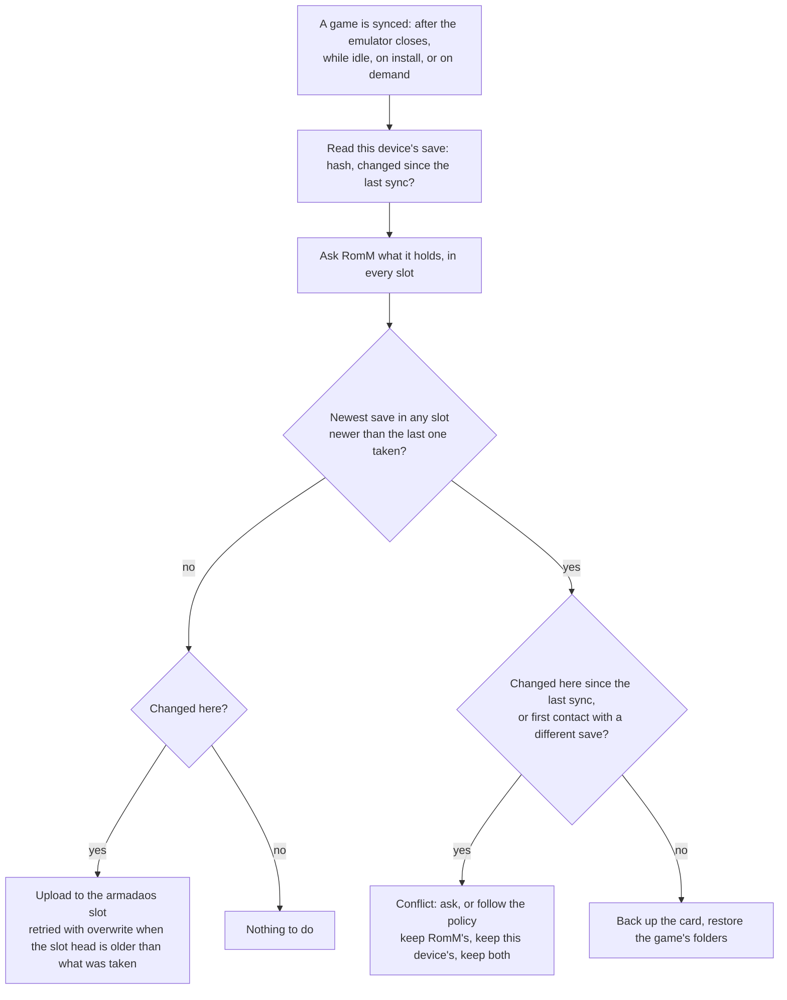

# Save formats

What can be on RomM for a PlayStation 2 save, which of it this plugin writes, which it reads, and how it chooses.

## The shapes

| Shape | Made by | What it looks like | Plugin reads | Plugin writes |
|---|---|---|---|---|
| **Save folders (zip)** | This plugin, Freegosy, Argosy on a RomM before 5.5 | A zip with the game's save folders at its root: `BASLUS-21269BULLY000/icon.sys`, … A few hundred KB | yes | **yes, the default** |
| **Freegosy bundle** | Freegosy | The shape above plus `freegosy_sync.txt` (ignored); older bundles also carry save states | yes | no |
| **sigil unit** | Argosy on servers that keep units, this plugin when asked | A `.ps2` memory card image of 8,650,752 bytes that holds only this game's saves | yes, through sigil | yes (card image format) |
| **Whole folder card in a zip** | Older clients | `Mcd001.ps2/_pcsx2_superblock` and every game's folders under `Mcd001.ps2/` | yes, only this game's folders are taken | no |
| **Memory card image in a zip** | Older Freegosy uploads | A zip that carries a `.ps2` of 4 MiB or more | yes, through sigil, only this game's saves | no |
| **Whole shared `.ps2` card** | Any client | A plain `.ps2` holding many games | yes, through sigil, only this game's saves | no |

A save that cannot be read is skipped once, with the reason on screen, and its id is remembered so it is not asked for
again. A save state filed as a save (`.state`, `.p2s`) is never taken for a memory card save.

## Slot and tag

Everything this plugin uploads is tagged `armadaos`: the **slot** (a setting) and the **emulator** field. The tag only
names the save. **Pulling ignores it:** a sync looks at every save RomM has for the game, whichever slot it is in.

## How a game's folders are found

A PCSX2 folder card is a directory (`Mcd001.ps2/`) with a `_pcsx2_superblock` file and one directory per save, named
`<region prefix><serial><suffix>`, for example `BASLUS21269BULLY000`. sigil gives the game's save id (`BASLUS-21269`).
A folder belongs to the game when its name starts with that id, ignoring `-` and `_` and case:

- A bare serial (`SLUS-21269`) gets its region prefix first: `BE` for PAL, `BI` for Japan and Korea, `BA` otherwise.
- A wrong region letter still matches, because the comparison is also made without the two-letter prefix.
- Several folders can be one game's (`BASLUS-20642SYS` and `BASLUS-20642RD0`).

## The content hash

RomM hashes a zip by its entries: the MD5 of the lines `name:md5(entry)`, sorted by name, joined with newlines. It is
the same on RomM 5.0.0 and 5.4.1. A save that did not change therefore hashes the same on every device, however it was
zipped. The plugin computes the same hash locally and uses it to decide whether a save changed. Anything that is not a
zip is hashed by its bytes, and so is a zip with an entry above 512 MiB, as RomM does.

## Choosing the format

`saves.format` (Settings → Saves → *Save format on RomM*):

| Value | Meaning |
|---|---|
| `folders` (default) | A zip of the game's save folders |
| `auto` | As Argosy does: the card image when the server's heartbeat says it keeps units (`SAVE_SYNC.SNAPSHOTS`), folders otherwise. The answer is remembered, so a sync made offline decides the same way |
| `card` | sigil's per-game card image |

Whatever the setting, a device whose memory card is a **file** uses the card image, because a file card cannot give
folders. When the format changes (the setting, or a server that was upgraded) the same save is uploaded once more in
the new format.

## Restoring

1. **Plan.** The archive is read before anything is written. A path that is absolute, has a drive letter or `..`, or a
   link refuses the whole archive. Only the game's folders are kept, the rest is counted as ignored, and what would be
   written may not exceed 64 MiB (nor any single entry). An archive with nothing for this game says what it does hold.
2. **Back up** the cards (`saves.backups`, the last few kept per game).
3. **Swap.** Each folder is unpacked beside the card first and moved in whole. The game's old folders go aside, and the
   game's folders the archive lacks are removed, so the card ends up holding what the archive holds. Nothing else on
   the card is touched. If anything fails, the new copies are removed and the old ones are put back.
4. File dates are taken from the archive, because PCSX2 reads a save's dates from its files when there is no index.

## How a sync decides

Nothing is replaced on a guess: a conflict is only ever settled by the user or by the policy they chose.
